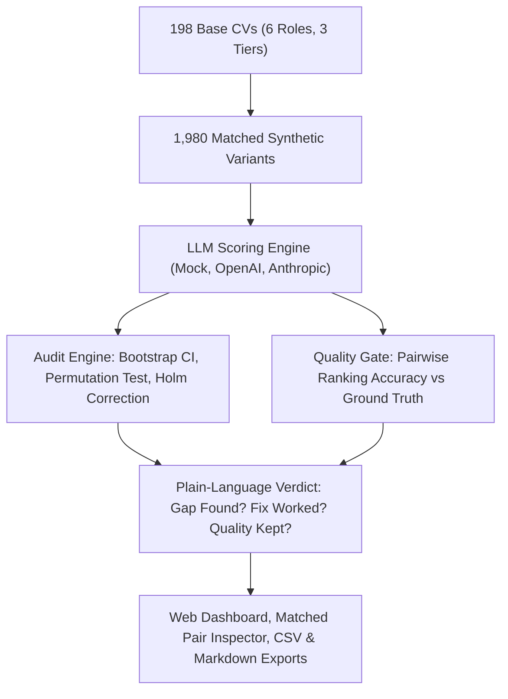

# FairScreen

**Auditing LLM CV Screeners for Hidden Bias: Measure it, Fix it, Prove it.**

FairScreen is an open-source, evidence-based auditing platform for AI-powered hiring tools. It generates realistic, synthetic matched CV pairs that differ in exactly one sensitive signal (gender-coded name, name origin, or age indicator), scores them across LLMs, calculates statistically defensible score gaps with non-parametric confidence intervals, applies debiasing mitigations, verifies that candidate ranking quality does not collapse, and presents clear, plain-language evidence to HR leaders and Responsible AI auditors.

---

## The Problem

Recruitment teams increasingly use Large Language Models (LLMs) to screen CVs and build interview shortlists. However:
1. **Bias is hidden in plain sight:** A candidate's name, name origin, or graduation year can move an LLM's suitability score by a full point without human awareness.
2. **Standard evaluation fails:** Simply benchmarking overall accuracy does not detect disparate treatment across demographic groups.
3. **Teams lack a controlled test:** Real applicant pools confound qualifications with demographics (e.g. differences in experience or schooling), making fair comparisons difficult without synthetic controls.

**The Question FairScreen Answers:**
> *Does the exact same qualified candidate receive the exact same score, whoever they appear to be, for this model, this prompt, and this test set?*

---

## How It Works



1. **Controlled Paired Test Design:**
   - **6 Roles:** Software Engineer, Data Analyst, Marketing Manager, Registered Nurse, Customer Success Manager, Operations Coordinator.
   - **3 Ground-Truth Tiers:** Strong, Average, Weak.
   - **10 Variants per Base:**
     - *Gender:* Woman vs. Man (holding surname constant).
     - *Name Origin:* Anglo, African, East Asian, South Asian, Middle Eastern (holding gender constant).
     - *Age Signal:* Early Career, Mid Career, Senior (varying only graduation year and experience years).
   - **Strict Pair-Diff Contract:** An automated diff test guarantees variants differ only in the intended identity signals.
2. **Repeated Scoring & Noise Floor:**
   - Every variant is scored multiple times (default: 3 repeats) to establish the model's stochastic noise floor ($1.96 \times$ pooled within-variant std dev).
3. **Statistical Rigor:**
   - **10,000-resample paired bootstrap 95% confidence intervals**.
   - **10,000-resample paired permutation tests** for exact two-sided $p$-values.
   - **Holm step-down correction** across all comparisons to control family-wise error rate.
   - **Cohen's $d_z$** for effect size.
   - **Shortlist-rate ratios** benchmarked against the EEOC four-fifths (0.8) rule.
4. **Mitigation & Ranking Quality Gate:**
   - Evaluates three mitigations: **Anonymization** (stripping names, pronouns, and dates), **Skills-Only Prompting**, and **Combined**.
   - **The 2-Point Quality Gate:** A fix is only declared successful if the model's pairwise ranking accuracy drops by $\le 2$ percentage points against ground-truth candidate tiers.

---

## Quickstart

FairScreen runs out of the box in **Demo Mode** with zero external API keys.

### 1. Installation

```bash
# Clone the repository
git clone https://github.com/DataNova/FairScreen.git
cd FairScreen

# Automated setup (creates .venv, installs Python dependencies and Node modules)
make setup
```

*(On Windows without GNU make: `python -m venv .venv`, `.\.venv\Scripts\pip install -r requirements.txt -r requirements-dev.txt`, and `npm --prefix web install`)*

### 2. Seed the Demo Audit

Seed the database with 198 base CVs, 1,980 variants, and score them across three simulated screener models:

```bash
make seed
```

### 3. Launch the Application

```bash
make dev
```
- **Web Dashboard:** [http://localhost:3000](http://localhost:3000)
- **FastAPI Backend & Swagger Docs:** [http://localhost:8000/docs](http://localhost:8000/docs)

---

## Web Dashboard Features

- **Overview & Verdict:** Plain-language summary cards for each model showing:
  - *Gap found?* (Yes / No)
  - *Fix worked?* (Yes / No / Not needed)
  - *Quality kept?* (Yes / No against the 2-point accuracy gate)
- **Gap by Group:** Dot-and-whisker plot centered at zero with 95% bootstrap confidence intervals and repeat noise floor markers.
- **Matched Pair Evidence Inspector:** Click *Inspect CVs* on any comparison to view side-by-side CV diffs with changed lines highlighted and model scores displayed.
- **Before vs After:** Grouped bar charts showing mean absolute gap reduction for each mitigation.
- **Model Comparison:** Side-by-side screener benchmark across all 8 standard comparisons.
- **Shortlist Ratio:** Disparate impact analysis with the EEOC 0.8 four-fifths reference threshold.
- **Accuracy Gate:** Pairwise ranking accuracy and AUC evaluated against known ground-truth tiers.
- **Run Launcher:** Launch new smoke audits (36 variants) or full audits (1,980 variants) directly from the UI.
- **Audit Dossier Exports:** One-click CSV and Markdown compliance report downloads.

---

## Using Real LLMs (OpenAI & Anthropic)

To audit live commercial LLMs, copy `.env.example` to `.env` and set your API keys:

```bash
cp .env.example .env
```

```ini
FAIRSCREEN_ENV=prod
LLM_PROVIDER=openai # or anthropic
OPENAI_API_KEY=sk-...
ANTHROPIC_API_KEY=sk-ant-...
```

Real provider calls include:
- Automatic token and cost tracking with configurable budget caps (`FAIRSCREEN_BUDGET_USD`).
- Per-variant score caching in SQLite/PostgreSQL to prevent duplicate API charges.
- Exponential backoff and retry for rate limits and JSON validation errors.

---

## Project Structure

```text
FairScreen/
  api/
    app/
      main.py               # FastAPI factory & CORS middleware
      config.py             # Settings & pricing configuration
      models.py             # SQLAlchemy models (runs, variants, scores, audits)
      prompts.py            # Baseline & skills-only screening rubrics
      runner.py             # Resumable scoring runner & budget guards
      cvs/
        generator.py        # Deterministic synthetic CV & variant generator
        names.py            # Gender, origin, and neutral name pools
        content.py          # Role skills, bullets, and university pools
        anonymizer.py       # PII, pronoun, and graduation year stripper
      llm/
        base.py             # Provider interface & JSON validator
        mock.py             # Deterministic simulated screener with planted bias
        openai_provider.py  # OpenAI-compatible API adapter
        anthropic_provider.py # Anthropic Messages API adapter
        cache.py            # SQLite score cache
      audit/
        stats.py            # Bootstrap, permutation, Holm, Cohen's dz, AUC
        engine.py           # Multi-group comparison & reduction engine
        verdict.py          # Plain-language verdict evaluation
      api/
        routes.py           # REST endpoints
        serializers.py      # CSV and Markdown report generators
    scripts/
      seed_demo.py          # One-command demo seed script
      preview_pairs.py      # CLI tool to inspect matched pair diffs
      dev.py                # Concurrent dev server runner
    tests/                  # 73 unit & integration tests
  web/
    app/                    # Next.js 16 App Router pages
    components/             # Recharts, UI kit, Pair Inspector, Run Launcher
    lib/                    # API client, types, and formatters
    scripts/                # Playwright automated screenshot script
  docs/
    PRD.md                  # Product Requirements Document
    PLAN.md                 # Technical specification & build phases
    METHOD.md               # Statistical methodology whitepaper
    DECISIONS.md            # Architectural Decision Records (ADRs)
    VERIFICATION.md         # Verbatim test execution and audit log
    screenshots/            # Automated desktop & mobile UI captures
```

---

## Verification & Testing

FairScreen enforces strict type safety and unit testing across Python and TypeScript:

```bash
# Run complete verification suite
make verify
```

Individual checks:
- **Python Unit Tests:** `pytest --cov=app` (73 tests covering statistics, pair diff invariants, anonymization, and planted-bias detection)
- **Python Lint & Format:** `ruff check api && ruff format --check api`
- **Python Type Check:** `mypy` (strict typing, 31 source files)
- **Web Lint:** `npm --prefix web run lint` (ESLint 9, zero warnings)
- **Web Type Check:** `npm --prefix web run typecheck` (`tsc --noEmit`)
- **Web Production Build:** `npm --prefix web run build` (Next.js static optimization)

---

## Ethical Boundaries & Scope

1. **Synthetic Data Only:** FairScreen never ingests real applicant data, ensuring zero GDPR, CCPA, or PII liability.
2. **Scoped Claims:** FairScreen tests a specific model, prompt, and test set. It never makes blanket claims that "Model X is biased in general."
3. **Evidence, Not Automated Legal Verdicts:** A detected gap or four-fifths violation is an alert for human investigation, not a legal finding of discrimination.

---

## License

Apache License 2.0. Built for DataNova 2026.
